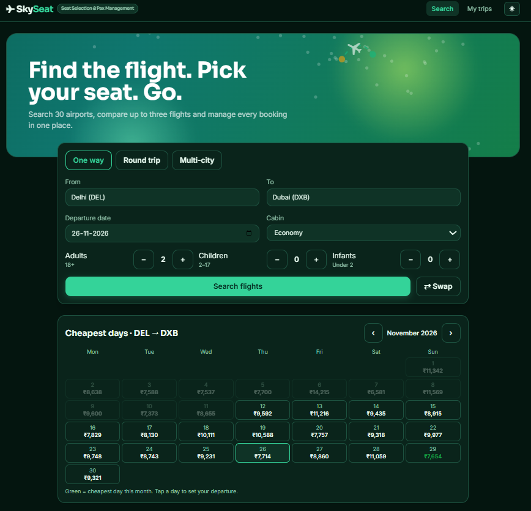
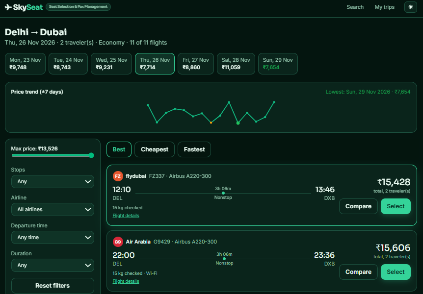
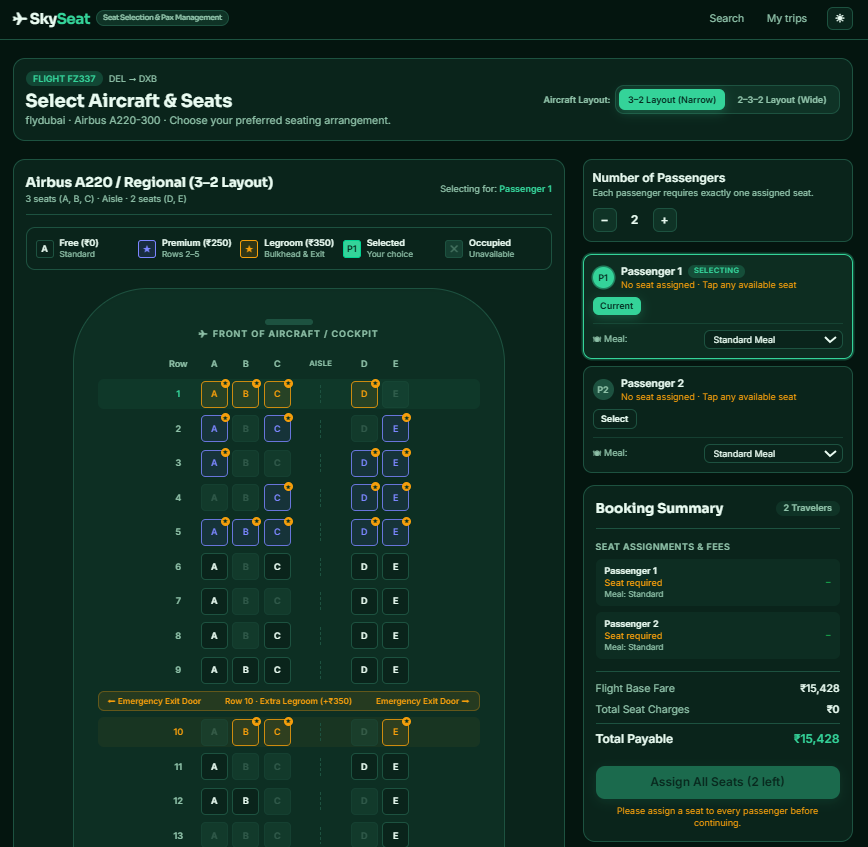
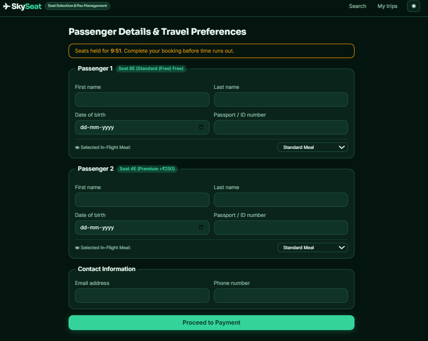

# SkySeat – Flight Seat Selection & Passenger Management

**SkySeat** is a frontend technical assessment project built with **React.js 19**, **Vite**, **Tailwind CSS**, and **Zustand**. It provides an aircraft seat selection and passenger management experience with dynamic layouts, real-time pricing in Indian Rupees (₹), seat availability states, and individual meal preferences.

Originally based on the open-source **AeroLink** project by Muhammad Faiz Alam, SkySeat extends the foundation with modular, assessment-specific components, configurable cabin layouts, and resilient state synchronization.

---

## 📸 Application Screenshots

### 1. Flight Search


### 2. Flight Results


### 3. Aircraft Seat Selection


### 4. Passenger Details


## Technical Assessment Requirements & Implementation

### 1. Aircraft Seat Layouts
- **3–2 Layout**: `A B C | Aisle | D E` (5 seats per row, regional/narrowbody).
- **2–3–2 Layout**: `A B | Aisle | C D E | Aisle | F G` (7 seats per row, twin-aisle widebody).
- **Dynamic Layout Switcher**: Allows users to seamlessly switch aircraft layouts on the fly.
- **Dynamic Component Generation**: The reusable `SeatMap` component dynamically renders rows and seat blocks without hardcoded columns or static grids.
- **Assignment Sanitation**: Switching layouts safely sanitizes seat selections—clearing seats that do not exist in the newly selected layout while preserving valid assignments.

### 2. Passenger Management
- **Configurable Passenger Count**: Users can adjust the number of travelers directly on the seat selection page (+ / −) or during flight search.
- **Individual Passenger Cards**: Displays each passenger separately with their designated seat, seat tier, fee, and assigned state.
- **One-Seat-Per-Passenger Rule**: Exactly one seat is assigned to each passenger.
- **Duplicate Prevention**: Selecting a seat already held by another passenger safely unassigns it from the previous passenger to prevent double-booking.
- **Seat Modification & Removal**: Individual "Remove" action buttons allow users to easily clear or change assignments.

### 3. Seat Availability & Visual States
Clear visual indicators and accessible buttons support all mandatory states:
- **Available (Free)**: Standard seating (₹0) with subtle border and clear hover states.
- **Available (Paid - Premium)**: Front rows 2–5 (+₹250) with indigo accent badge.
- **Available (Paid - Extra Legroom)**: Bulkhead row 1 and emergency exit rows (+₹350) with amber badge and exit door signage.
- **Selected**: Actively chosen seat highlighted in emerald/brand color with passenger indicators (`P1`, `P2`).
- **Occupied**: Deterministically generated taken seats, permanently disabled (`aria-disabled="true"`, `cursor-not-allowed`, opacity reduction).
- **Seat Legend**: Comprehensive legend displaying prices, tiers, and status badges.

### 4. Configurable Pricing in Indian Rupees (₹)
Configurable pricing model defined in `src/data/aircraft.js`:
- **Standard Seats**: ₹0 (Free)
- **Premium Seats**: ₹250
- **Extra-Legroom Seats**: ₹350
- Real-time updates: Base flight fare, seat fees, and add-ons dynamically recalculate on every selection, modification, or removal.
- Indian Rupees (`₹` formatted via `en-IN` locale) used consistently across Search, Results, Seat Map, Booking Summary, Payment, Boarding Pass, and Trip Management.

### 5. Booking Summary & Validation
- **Itemized Breakdown**: Displays passenger number/name, designated seat, individual seat fee, and meal selection.
- **Price Breakdown**: Base fare + Total Seat Charges + Extras = Grand Total.
- **Validation Guard**: "Continue to Passengers" button is strictly disabled until every traveler has a valid seat assigned, with a clear helper message indicating remaining seats.

### 6. Bonus Features
- **Individual Meal Selection**: Each passenger can individually choose their in-flight meal (Standard, Vegetarian Lacto-Ovo, Vegan Plant-Based, Jain, Halal / Asian, Gluten-Free / Diabetic, Child Friendly).
- **Responsive Aircraft Fuselage UI**: Designed for desktop, tablet, and mobile with horizontal scrolling containers for narrow screens.
- **Accessible Controls**: All seat buttons feature rich `aria-label` descriptions (Seat ID, Class, Price, Availability) and full keyboard navigation.
- **Realistic Aircraft Details**: Cockpit nose cone, emergency exit doors, lavatories, and galleys.

---

## Project Architecture

```
skyseat/
├── src/
│   ├── App.jsx                   # Navigation layout, theme toggle, routing, footer attribution
│   ├── pages.jsx                 # Search, Results, Compare, Seats, Passengers, Payment, Confirmation, Dashboard
│   ├── store.js                  # Zustand store (layoutId, seats, passengers, meals, pricing logic)
│   ├── index.css                 # Theme tokens, animations, print media queries
│   ├── components/
│   │   ├── SeatMap.jsx           # Reusable dynamic seat map & seat legend
│   │   ├── PassengerSelector.jsx # Passenger management, count controls & meal selectors
│   │   └── BookingSummary.jsx    # Real-time pricing summary with seat validation
│   └── data/
│       ├── aircraft.js           # Layout definitions (3-2, 2-3-2), pricing tiers (₹0, ₹250, ₹350)
│       ├── generator.js          # Deterministic flight generator with INR pricing
│       ├── airports.js           # Airport database with autocomplete
│       └── airlines.js           # Airline fleet metadata
├── scripts/
│   ├── verify-assessment.mjs     # Automated scenario verification test suite (28 test assertions)
│   └── smoke.mjs                 # End-to-end SSR page render verification
└── package.json
```

---

## Getting Started

### Installation
```bash
npm install
```

### Development Server
```bash
npm run dev
```
Open your browser at `http://localhost:5173`.

### Automated Verification & Testing
Run the comprehensive test suite verifying all assessment scenarios:
```bash
npm test
```
This runs:
1. `scripts/verify-assessment.mjs`: Tests layout configs, pricing tiers, duplicate prevention, price updates on change/removal, layout switching validation, and seat occupancy logic.
2. `scripts/smoke.mjs`: Tests SSR rendering for every route and component state.

### Production Build
```bash
npm run build
```

---

## Attribution & Credits

- This project was developed as a technical assessment for **SkySeat**.
- Built upon the open-source **AeroLink** foundation created by **Muhammad Faiz Alam**.
- Retained under MIT license attribution with original core data generator concepts preserved.
